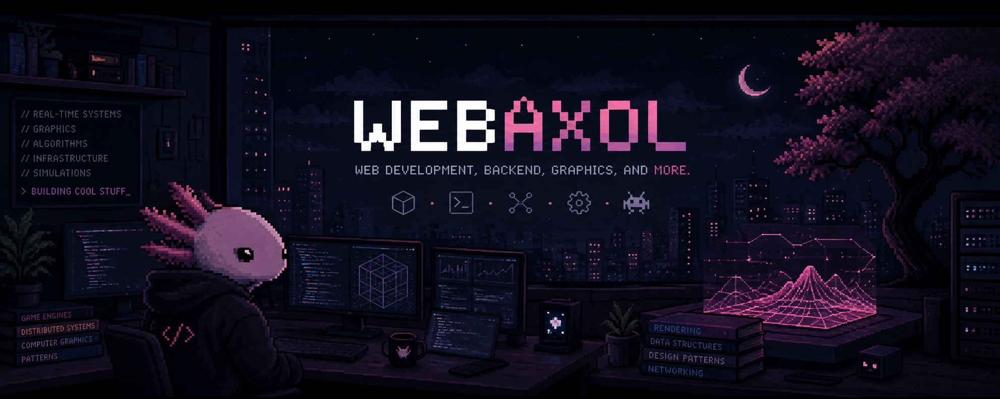
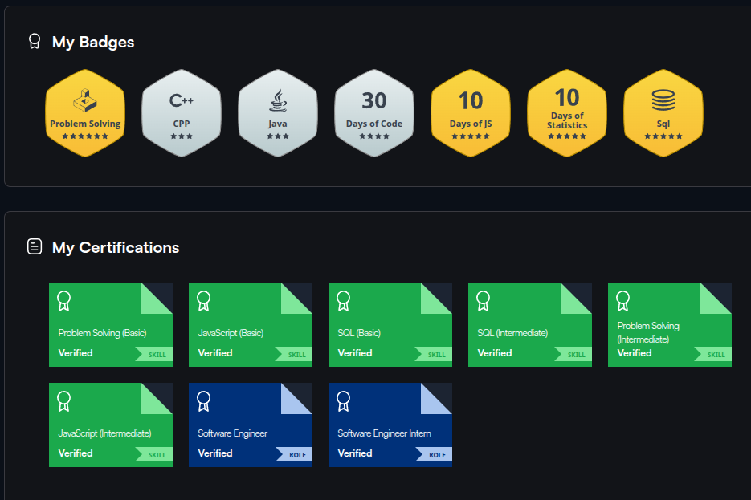
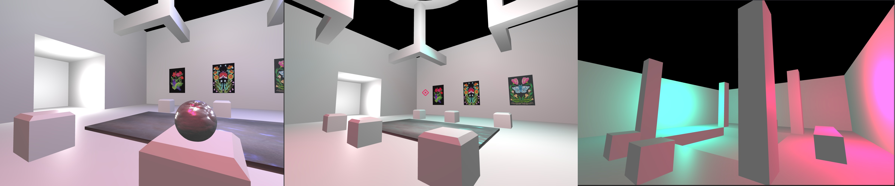

  

 

<ul>
  <li>🔭 I’m currently working on <a href="https://github.com/WebAxol/Rayven">Rayven</a> 🔥</li> 
   
  <li>🌱 I’m currently learning <b>Multi-agentic systems</b></li>
   
  <li>💬 Ask me about <b>computer graphics, algorithms, design patterns</b></li>
   
  <li>📫 How to reach me: <b>webaxol@gmail.com</b></li>
   
  <li>⚡ Fun fact: <b>I am left-handed (That ain't funny though)</b></li>
  
</ul>

<h3 align="left">Languages and Tools:</h3>

 
   
   
   
   
    
   
   
   
       

     
 

<h3 align="left">My Online Certificates</h3>

<a href="https://www.hackerrank.com/webaxol" target="blank">
My Hackerrank Profile</a>

  

<h3 align="left">Gallery</h3>

### [Rayven — Ray-Based Renderer](https://github.com/WebAxol/rayven)
Rayven is a hybrid raycasting and raymarching engine for rendering mirrors, reflections, and complex environments in TypeScript.

### [Rayven — Ray-Based Renderer](https://github.com/WebAxol/rayven)
An autonomous cotton-harvesting simulation featuring VR, intelligent harvesters and tractors, and agent-based pathfinding.

### Virtual 3D Museum — Private (Coming Soon)
An interactive 3D museum experience currently under development, designed to bring virtual spaces and digital exhibits together.

